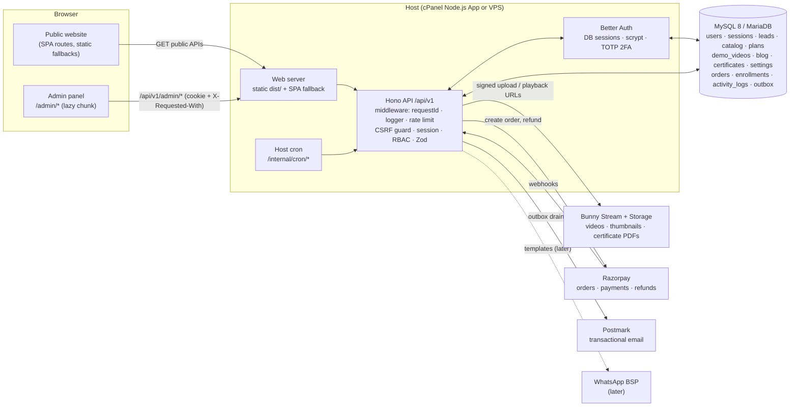

# Alpha Recover — Admin Panel Architecture

**Last reviewed:** 2026-11-13 · **Status:** Approved. **Foundation built on `Dev`:** lazy `/admin` route tree, staff login, layout with light/dark themes, role-aware dashboard, `GET /admin/me`, `GET /admin/dashboard`, create-admin CLI. React Query isn't added yet: it comes with the first data-table module.
**Related:** [FOLDER_STRUCTURE.md](FOLDER_STRUCTURE.md) · [NAVIGATION.md](NAVIGATION.md) · [AUTH_AND_RBAC.md](AUTH_AND_RBAC.md) · [UI_UX.md](UI_UX.md) · [SECURITY.md](SECURITY.md) · system-wide: [../ARCHITECTURE.md](../ARCHITECTURE.md), [../API.md](../API.md) §10–14, [../PLAN.md](../PLAN.md) Phase 6

> **Reference used:** the admin module plan in `docs/PLAN.md` (Phase 6 table), the role matrix in `docs/SECURITY.md` §2 and the `/admin/*` inventory in `docs/API.md`. The separate "Admin Panel Audit and Development Plan" mentioned in the task wasn't included in this conversation; if it exists, reconcile it with this document.

---

## 1. Verified starting point (2026-11-13)

| Area | What exists today | Gap for the admin panel |
|---|---|---|
| Frontend | Vite + React 19 SPA; all routes in `src/App.tsx` under the public `<Layout>`; dark-only design tokens in `src/styles/global.css` | No admin routes, layout, tables, forms or light theme |
| Backend | Hono API on Node (`server/`), routes: health, auth (session only), leads, catalog, plans, demo videos, blog, certificates, settings, internal cron | No `/admin/*` routes |
| Auth | Better Auth on MySQL; DB sessions in `ar.session_token` cookie (30 days); `GET /auth/session` only | **No login/logout/register endpoints yet** (backend Phase 3); no 2FA; no staff session limits |
| Roles | `users.role` enum: `student`, `support`, `content_manager`, `admin`, `super_admin` | No **Finance Manager**; "Support Manager" = existing `support` |
| Permissions | `server/auth/permissions.ts`: read/write-level strings, `requireStaff(permission)` middleware, refund limit constant | No view/add/edit/delete/export/import granularity; matrix lives only on the server |
| Audit | `activity_logs` table + `logActivity()` helper | Not yet called by any admin action (none exist) |
| Data an admin can manage today | users, leads, courses/modules/lessons, plans/promotions, demo_videos, blog_posts, certificates, site_settings, notification_jobs, activity_logs | **Missing tables:** enrollments, orders, payments, payment_webhook_events, lead_notes, coupons, learning_materials |

## 2. Recommendation: `/admin` inside the existing SPA, lazy-loaded

**Build the admin panel as a separate route tree, `/admin/*`, in the same Vite app**:
- **Code-split:** `React.lazy` keeps it out of the public bundle.
- **Own layout:** its own sidebar and top bar, with no public Header or Footer.
- **Own styles:** CSS scoped under `.adm` with light and dark tokens.
- **Same backend:** it talks to the same Hono API under `/api/v1/admin/*` and the same MySQL database.

### Why this fits Alpha Recover

| Criterion | `/admin` in the same SPA (recommended) | Separate admin app (e.g. `admin.alpharecover.com`) |
|---|---|---|
| Hosting (cPanel or VPS, undecided) | One build, one upload, one Node app; works on shared hosting | A second build and deploy target, and often a second domain/SSL setup on cPanel |
| Auth | Same origin → same `ar.session_token` cookie, same CSRF guard; no cross-domain cookies or CORS | Needs a cross-subdomain cookie or separate login, plus CORS configuration |
| Reuse | Shares `src/lib/api.ts`, `shared/` permission matrix and Zod schemas, `Markdown` preview, brand tokens and icons | Shared code needs a package/monorepo setup |
| Public bundle size | Zero impact: the admin is a lazy chunk loaded only on `/admin` | Zero impact |
| Isolation | The admin chunk is downloadable by anyone (harmless: every API call is authorized server-side) | Admin code is not publicly reachable (defence in depth) |
| Team size / maintenance | One repo, one CI, one set of conventions; fits a 1–2 person team | More moving parts |

**Verdict:** the same-SPA approach has the least complexity and uses the most existing code. The isolation benefit of a separate app is small, because **authorization lives in the API, never in the UI**. If staff ever need IP-allow-listing or stricter isolation, the `src/admin/` folder is self-contained and can be lifted into its own Vite entry or subdomain later, with no backend change.

**Not recommended:** a separate database. Admin data *is* the business data (leads, orders, students), and splitting it would mean cross-database joins and duplicated users. The audit trail goes in the same database's append-only `activity_logs`.

### How it plugs into the current app

```tsx
// src/App.tsx (proposal, not implemented)
const AdminApp = lazy(() => import('./admin/AdminApp'));
<Routes>
  <Route path="admin/*" element={<Suspense fallback={<AdminBoot />}><AdminApp /></Suspense>} />
  <Route element={<Layout />}>{/* public routes unchanged */}</Route>
</Routes>
```
The admin route sits **outside** the public `<Layout>` and **before** the catch-all `*` redirect. Public pages, styles and bundle stay unchanged.

## 3. Backend integration

### Reuse as-is
- **Middleware:** request context, logging, security headers, the CSRF guard, the error envelope, the MySQL rate limiter, `validate()` and `requireStaff()`.
- **Services:** `loadCatalog()`, `loadPlans()` / `priceFor()`, `getSetting()` / `getPublicSettings()`, `verifyCertificate()` and `allocateCertificateCode()`, `enqueueEmail()` and `drainOutbox()`.
- **Audit:** `logActivity()`, called on **every** admin mutation.

### New API surface: `/api/v1/admin/*`
This is already inventoried in [../API.md](../API.md) §10–14. Additions this plan needs:

| Endpoint | Why |
|---|---|
| `GET /admin/me` | The current staff user, their role, their **effective permission list** and their 2FA status. The UI renders from this; the server stays the source of truth |
| `POST /admin/auth/2fa/*` (Better Auth twoFactor plugin) | TOTP enrolment and verification for staff |
| `POST /admin/auth/step-up` | Re-confirm the password or TOTP before sensitive actions (refund, role change, delete) |
| `GET /admin/search?q=` (P2) | Global search across leads, students, orders and certificates for the command palette |
| `GET /admin/<module>/export.csv` | Exports, gated by `*.export` permissions |

Every route uses `requireStaff('<module>.<action>')` (see [AUTH_AND_RBAC.md](AUTH_AND_RBAC.md)), Zod validation, pagination (`page`, `pageSize` ≤ 100), and `logActivity()` on mutations.

### Database changes required (later phases; none made now)

| Change | For | When |
|---|---|---|
| `users.role` enum: add `finance_manager`; rename `support` → `support_manager` (expand/contract) | New role set | Admin foundation |
| Better Auth `twoFactor` tables (`two_factors`, `users.two_factor_enabled`) | Staff 2FA | Admin foundation |
| `lead_notes` | Leads module notes and status history | Leads module |
| `enrollments` | Enrollments module, course access | Backend Phase 3/5 |
| `orders`, `payments`, `payment_webhook_events` | Orders & Payments module | Backend Phase 5 |
| `coupons` (+ `orders.coupon_id`) | Offers & Coupons | Deferred (no coupon UI on the site yet) |
| `learning_materials` | Learning Materials | Deferred (no feature on the site yet) |

### Dependency on backend phases
The admin panel **cannot be used until staff can log in**, which arrives with backend **Phase 3 (accounts)**. Modules for enrollments and orders also need their tables from backend Phases 3 and 5. The recommended order is in §6.

## 4. Frontend libraries (proposal; nothing installed now)

Keep the public site's "three runtime dependencies" rule. The admin chunk may add **only**:

| Package | Why | Loaded |
|---|---|---|
| `@tanstack/react-query` | Server-state caching, pagination, mutations and invalidation for dozens of tables; avoids hand-rolled stale-data bugs | Admin chunk only |
| `zod` (already a server dependency) | Share the exact request schemas from `shared/schemas/admin/*` for client-side form validation | Admin chunk only |

**Not added:**
- **No UI kit and no table library.** Components are built in-house with the brand tokens, matching the public site's "custom CSS" convention.
- **No chart library at first.** P0/P1 KPIs use stat cards and CSS bars. A small chart library can be considered for P2 Reports.
- **No rich-text editor.** Blog editing is Markdown with a live preview through the existing `Markdown` component.

## 5. Architecture diagram



```mermaid
sequenceDiagram
  participant S as Staff browser (/admin)
  participant A as API
  participant B as Better Auth
  participant D as MySQL
  S->>A: GET /api/v1/admin/me (cookie)
  A->>B: getSession(headers)
  B->>D: sessions + users
  A-->>S: 401 → /admin/login · 403 (student) → "no access" · 200 {role, permissions}
  S->>A: PATCH /api/v1/admin/leads/:id (X-Requested-With: fetch)
  A->>A: csrfGuard → requireStaff('leads.edit') → validate(zod)
  A->>D: UPDATE leads … ; INSERT activity_logs …
  A-->>S: 200 {data}
```

## 6. Recommended build order (maps to docs/PLAN.md)

| Step | Admin work | Needs first |
|---|---|---|
| 1 | **Admin foundation:** lazy `/admin` shell, login + 2FA, `GET /admin/me`, permission matrix moved to `shared/`, role enum migration, layout/sidebar/theme, core components (table, drawer, modal, forms, toasts) | Backend Phase 3 (login endpoints) |
| 2 | **P0 modules:** Dashboard (lead + content KPIs), Leads (+ `lead_notes`), Students, Team & Access, Activity Log | Step 1 |
| 3 | **P1 content:** Courses & Training, Plans & Offers (promotions), Demo Videos, Blog, Site Settings, Certificates | Step 1 (video upload needs Bunny, Phase 4) |
| 4 | **P1 commerce:** Enrollments, Orders & Payments, refunds | Backend Phases 3 and 5 |
| 5 | **P2:** Reports & Analytics, Notifications log, global search / command palette, Coupons, Learning Materials | Data from steps 2–4 |

Per-module details: [NAVIGATION.md](NAVIGATION.md) §3.

## 7. Architectural risks

| Risk | Mitigation |
|---|---|
| Admin built before login exists | Do backend Phase 3 first; the admin shell is step 1 only once `/auth/login` works |
| Permission drift between UI and API | One matrix in `shared/permissions.ts`, imported by both; UI renders from `GET /admin/me`; a test generates every admin route × role (docs/TESTING.md) |
| Admin chunk leaks structure to the public | Accepted: no secrets in frontend code; every endpoint authorizes. `/admin` is excluded from indexing (`noindex` + robots.txt) |
| Role enum change on a live database | Expand/contract migration: add new values, move rows, drop old values in a later release |
| Shared hosting limits (memory, processes) under admin exports | Stream CSV exports in pages of 500; cap export size; run heavy reports off-peak |
| Light theme leaking into the public site | All admin tokens scoped under `.adm[data-theme]`; public `global.css` is never edited for admin needs |
| Scope creep (17 modules) | P0/P1/P2 gating; Coupons and Learning Materials deferred until the site has those features |
