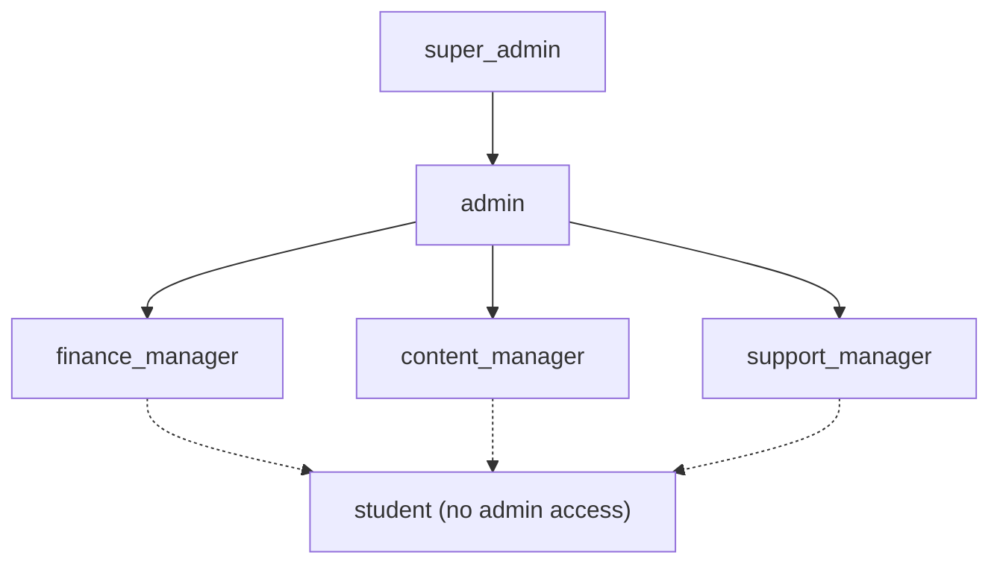
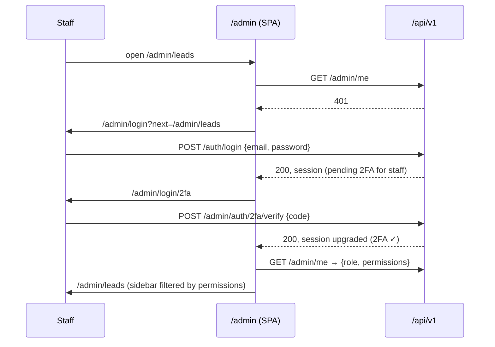

# Alpha Recover — Admin Authentication & RBAC

**Last reviewed:** 2026-11-13 · **Status:** **Roles and matrix approved and implemented (2026-11-13):** `users.role` migrated (`finance_manager` added, `support` → `support_manager`), matrix in `shared/permissions.ts`, `GET /admin/me`. **2FA: optional for now (owner's decision)**, built in a later admin piece. Staff session limits (8h / 30 min idle) also come later.
**Related:** [ARCHITECTURE.md](ARCHITECTURE.md) · [NAVIGATION.md](NAVIGATION.md) · [SECURITY.md](SECURITY.md) · [../SECURITY.md](../SECURITY.md)

## 1. Current system (verified in code, 2026-11-13)

| Item | Today | Supports the admin panel? |
|---|---|---|
| Identity | Better Auth (`server/auth/auth.ts`), email + password, scrypt hashes in `accounts` | ✅ Foundation is there |
| Sessions | DB-backed, cookie `ar.session_token` (`__Secure-` on HTTPS), HttpOnly, SameSite=Lax, 30-day expiry, refreshed daily | ⚠️ Too long for staff; no per-role lifetime, no session limit |
| Login endpoints | **None.** Only `GET /api/v1/auth/session` | ❌ Blocker: backend Phase 3 adds `/auth/login`, `/auth/logout` |
| 2FA | **Not configured** | ❌ Needed for staff |
| Roles | `users.role` enum: `student`, `support`, `content_manager`, `admin`, `super_admin` | ⚠️ No Finance Manager; Support Manager = `support` |
| Permission model | `server/auth/permissions.ts`: `module.read` / `module.write` (+ `orders.refund`, `leads.export`, `blog.publish`, `admins.manage`…); `requireStaff(permission)` middleware; `ADMIN_REFUND_LIMIT_PAISE` | ⚠️ Works, but has no view/add/edit/delete/export/import split; server-only (UI can't share it) |
| Role assignment | `role` and `status` are `input: false` in Better Auth, so sign-up can't set them (tested) | ✅ |
| Suspension | `users.status = suspended` → `requireUser` / `requireStaff` return 403 | ✅ |
| Audit | `activity_logs` + `logActivity()` | ✅ (to be called by every admin mutation) |

**Conclusion:** the existing system **does not yet support the requested roles or action-level permissions**. It needs a role enum migration, a refined permission matrix shared with the UI, staff session rules, 2FA and the login endpoints.

## 2. Roles

### Final role set

| Role (enum value) | Who | Summary |
|---|---|---|
| `super_admin` | Owner | Everything, including team, roles, policies and unlimited refunds. At least one must always exist |
| `admin` | Operations manager | All modules; can view the team but not change roles; refunds up to ₹5,000; can't edit Policies |
| `finance_manager` (**new**) | Accounts | Orders, payments, refunds, plans and promotions (pricing), revenue reports, enrollments tied to payments |
| `content_manager` (existing) | Course and content team | Courses, lessons, demo videos, blog; content reports |
| `support_manager` (**renamed from `support`**) | Sales / support desk | Leads, student accounts (contact details, password reset, sessions), view orders and enrollments, email log |
| `student` | Learners | No admin access |

**Migration (implementation phase, expand/contract):**
1. Add `finance_manager` and `support_manager` to the enum.
2. Run `UPDATE users SET role='support_manager' WHERE role='support'`.
3. Remove `support` in a later release.

No staff users exist yet, so the risk is minimal.

### Hierarchy

The hierarchy only governs **who can manage whom**:
- Only `super_admin` can assign or change roles, or create another `super_admin`.
- `admin` can deactivate or reset `*_manager` accounts, but not `admin` or `super_admin` ones.
- Nobody can change their own role.
- The last `super_admin` can't be demoted or deactivated.

Permissions themselves are **explicit per role**, never inherited implicitly. That keeps the matrix auditable.

## 3. Permission model

Permission strings are `module.action`.

**Actions:** `view`, `add`, `edit`, `delete`, `export`, `import`.

**Special actions** for high-risk operations:
- `orders.refund`
- `enrollments.revoke`
- `certificates.revoke`
- `blog.publish`
- `team.manage_roles`
- `settings.edit_policies`

### Module × role matrix

V view · A add · E edit · D delete · X export · I import · ★ special action · — none

| Module | super_admin | admin | finance_manager | content_manager | support_manager |
|---|---|---|---|---|---|
| dashboard | V | V | V (revenue widgets) | V (content widgets) | V (lead widgets) |
| leads | V A E D X I | V A E D X I | — | — | V A E X I |
| students | V A E D X | V A E D X | V | — | V E (contact, reset, sessions) |
| enrollments | V A E X ★revoke | V A E X ★revoke | V A X ★revoke | — | V |
| orders | V E X ★refund (any) | V E X ★refund (≤ ₹5,000) | V E X ★refund (any) | — | V |
| courses | V A E D I | V A E D I | — | V A E D I | — |
| plans (incl. promotions) | V A E D | V A E D | V A E D | V | — |
| demos | V A E D | V A E D | — | V A E D | — |
| blog | V A E D ★publish | V A E D ★publish | — | V A E D ★publish | — |
| certificates | V A E X ★revoke | V A E X ★revoke | — | — | V |
| reports | V X (all tabs) | V X (all tabs) | V X (revenue) | V (content, learning) | V X (leads) |
| audit (activity log) | V X | V X | — | — | — |
| team | V A E D ★manage_roles | V | — | — | — |
| notifications (email log) | V E (retry) | V E | — | — | V E |
| settings | V E ★edit_policies | V E (general, site & contact) | — | — | — |

**Mapping to today's strings** (for the migration): `*.read` → `*.view`; `*.write` → `*.add` + `*.edit` (+ `*.delete` where the old role had write); `leads.export` stays; `admins.manage` → `team.add/edit/delete` + `team.manage_roles`; `audit.read` → `audit.view`; `settings.write` → `settings.edit` + `settings.edit_policies`.

**Where it lives:** `shared/permissions.ts` exports `ROLES`, `PERMISSIONS`, `ROLE_PERMISSIONS`, `can(role, permission)` and `REFUND_LIMITS` (`admin: 500000` paise; others unlimited or none). Both the API and the UI import it. The UI never decides access alone.

## 4. API-level authorization

- `server/routes/admin/index.ts` applies a baseline `requireStaff()`: logged in, active, not a student, and **2FA completed** where required.
- **Every route** additionally declares its exact permission, e.g. `requireStaff('leads.edit')`. There are no blanket "is staff" routes.
- **Amount and target checks inside handlers:**
  - refund amount vs `REFUND_LIMITS[role]`
  - role changes, using the hierarchy rules in §2
  - suspending users with a higher role
- **Step-up** (`requireStepUp()`): password or TOTP re-confirmed within the last 10 minutes for refunds, role changes, deletes, certificate revocation, policy edits and CSV exports of personal data.
- **Field whitelists:** update schemas list allowed fields, so `role`, `status`, `email_verified`, amounts and ids can't be mass-assigned.
- **Audit:** every mutation calls `logActivity()` with actor, role, action, entity and before/after metadata. Denied attempts on sensitive actions (`auth.forbidden`) are logged too.
- **Tests:** a generated suite hits **every admin route × every role** and compares the result with `can()`. A new route without a permission fails CI.

## 5. Admin authentication flow

- **One identity system:** staff are `users` rows with a staff role. The same Better Auth login is used with an **admin-specific login page** (`/admin/login`). Students who sign in there see "This account doesn't have admin access".
- **2FA (TOTP)** through the Better Auth `twoFactor` plugin:
  - **Required** for `super_admin`, `admin` and `finance_manager`.
  - **Strongly recommended** for the other staff roles, and enforceable later via a policy setting.
  - First login forces enrolment (QR code plus 10 backup codes).
- **Invites:** staff are created by invite. A `super_admin` enters an email and role, and the invitee receives a single-use link (24h) to set a password and enrol 2FA. There's no public staff sign-up.

## 6. Session handling

| Rule | Students (today / Phase 3) | Staff (proposal) |
|---|---|---|
| Lifetime | 12h, or 30d with "remember me" | **8h absolute**; **30 min idle** timeout (activity refreshes it) |
| Concurrent sessions | 2 | 3 |
| Cookie | `ar.session_token`, HttpOnly, Secure, SameSite=Lax | Same cookie (same origin); the role is checked on every request, not stored in the cookie |
| Rotation | On login and password change | Also on role change and 2FA enrolment; **all sessions revoked** on role change, deactivation or password reset |
| Visibility | — | Account page lists active sessions (device, IP, last active) with "sign out" per session and "sign out everywhere" |
| Login protection | 5 failures / 15 min | Same + email alert to the staff member on each new-device login |

## 7. Protected routes (frontend)

- `<RequireStaff>` wraps the admin shell:
  - while `GET /admin/me` loads → a skeleton shell
  - 401 → redirect to `/admin/login?next=<path>`
  - 2FA pending → `/admin/login/2fa`
  - student or suspended → `NoAccessPage`
- `<RequirePermission perm="leads.view">` wraps each route. Without the permission it renders a 403 view; the sidebar hides the item anyway.
- **Actions** (buttons, row menus, bulk actions) use `can('leads.export')` and are **hidden** when not allowed. Visible-but-disabled is reserved for limits like "refund above your limit → ask a super admin".
- `routes.ts` is the single source: each route declares its permission, so router, sidebar and breadcrumbs can't disagree.

## 8. Unauthorized access handling

| Situation | API | UI |
|---|---|---|
| Not logged in or session expired | `401 UNAUTHENTICATED` | Save the unsaved form draft locally → redirect to login with `next` → return after login |
| Logged in, missing permission | `403 FORBIDDEN` (+ `auth.forbidden` audit entry for sensitive actions) | 403 page for routes; a toast "You don't have permission to do this" for actions |
| Suspended / role removed mid-session | 403 on the next request (sessions already revoked) | Sign out, then a message |
| Step-up required | `403 STEP_UP_REQUIRED` | StepUpDialog, then retry the action automatically |
| Over refund limit | `422 BUSINESS_RULE` with the limit | Inline message: "Refunds above ₹5,000 need a super admin" |
| Too many attempts | `429` + `Retry-After` | Countdown message |
